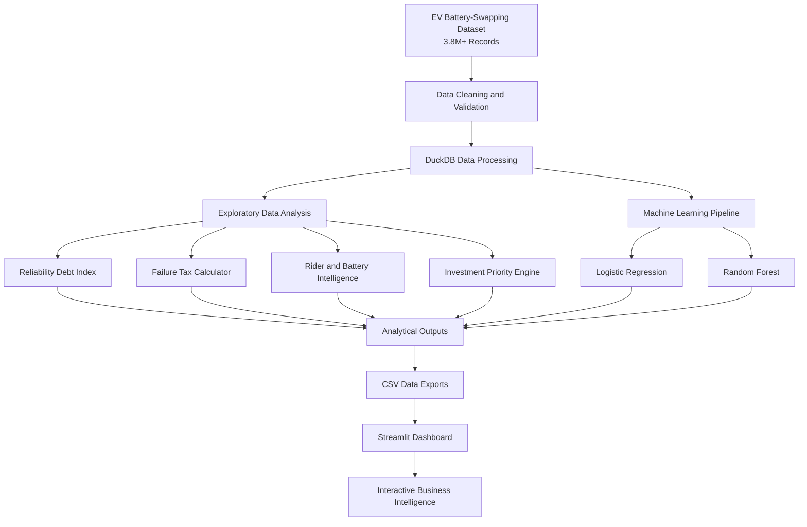

# THE FAILURE TAX

### An Explainable Reliability-to-Profit Intelligence System for EV Battery-Swapping Networks

  <strong>Turning EV battery-swapping failures into measurable financial intelligence.</strong>

  <a href="https://uzaimasariya-the-failure-tax-the-failure-tax-deployapp-vdtgzc.streamlit.app/">
    <strong>🚀 LIVE DASHBOARD</strong>
  </a>
  &nbsp; | &nbsp;
  <a href="https://github.com/uzaimasariya/THE-FAILURE-TAX">
    <strong>📂 GITHUB REPOSITORY</strong>
  </a>

---

## 1. Overview

THE FAILURE TAX is a data-driven reliability and financial intelligence platform designed for electric vehicle (EV) battery-swapping networks.

It identifies operational failures, measures their estimated financial exposure, evaluates station reliability, analyzes rider and battery patterns, and recommends where operational improvements should be prioritized.

Unlike conventional analytics dashboards that primarily report what happened, THE FAILURE TAX connects operational reliability with financial consequences and investment decisions.

**Our central question:**

> How much money does an EV battery-swapping network lose due to unreliable swaps, and where should it invest to prevent those losses?

## 2. Problem Statement

Battery-swapping networks face several operational challenges:

- Battery unavailability at swapping stations.
- Failed or interrupted swapping attempts.
- Long rider waiting times.
- Uneven station reliability.
- Battery health and supplier-related variations.
- Potential loss of revenue and rider trust.

These failures are often analyzed separately.

THE FAILURE TAX brings these dimensions together into one explainable decision-support system.

## 3. Dashboard Preview

Explore the live dashboard:

**[🚀 Open THE FAILURE TAX Dashboard](https://uzaimasariya-the-failure-tax-the-failure-tax-deployapp-vdtgzc.streamlit.app/)**

## 4. Dashboard Screenshots

### Screenshot 1

### Screenshot 2

### Screenshot 3

### Screenshot 4

### Screenshot 5

### Screenshot 6

## 5. Key Features

### 5.1 Executive Overview

Provides a network-wide summary of operational performance, completed swaps, failed attempts, revenue and reliability indicators.

### 5.2 Reliability Debt Index (RDI)

Introduces a station-level composite reliability score using:

- Failure rate.
- Rider abandonment rate.
- Queue waiting time.
- Battery stockout indicators.
- Customer support complaints.

Stations are classified into Low, Moderate, High and Critical risk categories.

### 5.3 Failure Tax Calculator

Estimates the gross revenue exposure associated with failed swapping attempts using historical realized revenue.

### 5.4 Investment Decision Simulator

Combines station reliability and financial exposure to prioritize stations for operational interventions.

Evaluates conservative, moderate and aggressive failure-reduction scenarios.

### 5.5 Rider Intelligence

Analyzes rider activity and subsequent return behavior across different failure-exposure groups.

### 5.6 Battery and Supplier Intelligence

Examines battery health, age, supplier and manufacturing-lot associations with operational failures.

### 5.7 Machine Learning Intelligence

Compares Logistic Regression and Random Forest models for failure classification and evaluates their performance.

## 6. System Architecture

## 7. Technology Stack

| Category | Technologies |
|---|---|
| Programming | Python |
| Data Processing | Pandas, NumPy |
| Large-Scale Analytics | DuckDB |
| Machine Learning | Scikit-learn |
| Visualization | Plotly |
| Dashboard | Streamlit |
| Development | Google Colab, GitHub |

## 8. Dataset

The project analyzes EV battery-swapping operational data from multiple interconnected datasets:

- Swap events.
- Station information.
- Station-hourly operational status.
- Rider information.
- Battery information.
- Support tickets.
- City-level daily context.
- Fleet partner information.

Approximately 3.8 million non-test event records were analyzed.

Data cleaning, validation, timestamp correction and entity matching were performed before analysis.

## 9. Key Analytical Findings

The analysis produced several important findings:

- **₹91.64 lakh:** Estimated gross revenue exposure from failed swapping attempts.
- **150 stations:** Included in the station reliability analysis.
- **72 stations:** Classified as High or Critical reliability risk.
- **28 critical stations:** 22 are located in Jaipur and Delhi NCR.
- **Heat-alert association:** Observed failure rates were substantially higher during heat-alert periods.
- **Investment prioritization:** A combined reliability and financial exposure score identifies high-priority stations.

These are analytical estimates and observed associations, not proof of causation or confirmed financial losses.

## 10. Machine Learning

The project explores binary classification of successful and failed battery-swapping attempts.

**Models evaluated:**

- Logistic Regression.
- Random Forest.

**Evaluation metrics:**

- Accuracy.
- Precision.
- Recall.
- F1 Score.
- ROC-AUC.
- PR-AUC.

The experiments highlight the importance of evaluating feature timing and potential data leakage before treating a model as an operational early-warning system.

## 11. Methodology

1. Data ingestion and exploration.
